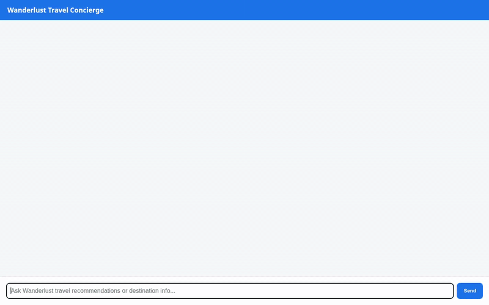

# Wanderlust Travel Concierge

An AI-powered conversational travel concierge built with the Google Agent Development Kit (ADK) and Gemini 2.5 Flash. Wanderlust Travel Concierge helps travelers discover destinations, search curated venues, check live weather, convert currencies, geocode landmarks, generate AI destination artwork and promotional videos, and render interactive UI cards via A2UI.



---

## Overview

Wanderlust Travel Concierge provides personalized travel planning by combining real-time APIs, persistent memory, multimodal generation, and structured UI rendering. It maintains user preferences and allergies across conversations while serving curated recommendations from a Google Cloud Firestore database.

---

## Key Capabilities & Wired Tools

The following tools and services are implemented and wired in `app/agent.py`:

### 🧠 Persistent Memory (Vertex AI Memory Bank)
- **User Preference Retention**: Integrates `VertexAiMemoryBankService` and `PreloadMemoryTool` to remember user facts, travel budget style, dietary restrictions, allergies (e.g., gluten-free, peanut allergy), and past visited cities across chat sessions.
- **Automated Memory Extraction**: Configured with an `after_agent_callback` (`generate_memories_callback`) to extract conversation session facts into the Memory Bank after each turn.

### 🏛️ Curated Destination Catalog (Google Cloud Firestore)
- **Destination Database**: Stores and queries travel recommendations in a Firestore `destinations` collection.
- **Destination Search** (`search_destinations`): Filters curated spots by city, category (*Scenic & Outdoor*, *Culture & Heritage*, *Dining & Gastronomy*), or keyword tags.
- **Venue Details** (`get_destination_details`): Fetches complete descriptions, ratings, price tiers, and tags for specific destination IDs.
- **Add Destination** (`add_destination`): Adds new user-recommended spots directly to Firestore.

### 🖼️ Multimodal AI Generation & Storage (Gemini + Cloud Storage)
- **AI Postcard Image Generation** (`generate_destination_image`): Uses `gemini-3.1-flash-lite-image` via Vertex AI to generate high-quality destination artwork and postcard images.
- **AI Promotional Video Generation** (`generate_destination_video`): Uses `gemini-omni-flash-preview` via Vertex AI to generate short travel video clips.
- **Public Cloud Storage Hosting**: Uploads generated images and videos to a public Google Cloud Storage bucket (`wanderlust-travel-assets-qwiklabs-gcp-03-faf61ce9a80f`) and returns public HTTPS URLs.

### 📱 Interactive Structured UI (A2UI)
- **Component Cards**: Uses `A2uiSchemaManager` and `BasicCatalog` paired with an `after_model_callback` (`a2ui_callback`) to return structured UI components (Card, Column, Row, Text, Image) for interactive display in supported clients.

### 🧮 Secure Code Sandbox
- **Code Execution** (`AgentEngineSandboxCodeExecutor`): Runs Python code calculations in an Agent Engine sandbox environment to perform travel cost breakdowns, budget math, and custom computations.

### 🌐 Real-Time Location & Travel Tools
- **Live Weather** (`fetch_live_weather`): Fetches real-time temperatures, relative humidity, and wind speed for any city worldwide using the Open-Meteo API.
- **Currency Conversion** (`convert_travel_currency`): Performs live foreign exchange rate conversions using the Frankfurter FX API.
- **Google Maps Geocoding** (`geocode_address`): Converts addresses and landmark names into latitude and longitude coordinates using the Google Maps Geocoding API.
- **Nearby Places Search** (`find_nearby_places`): Discovers nearby attractions, restaurants, cafes, and lodging using the Google Places API (New).
- **Current Time Lookup** (`get_current_time`): Returns formatted current timestamps across world timezones.

### 📊 Observability & Telemetry
- **Cloud Trace & Logging**: Configured via `setup_telemetry()` and `setup_agent_engine_telemetry()` to log GenAI telemetry and execution traces to Google Cloud.

---

## Technical Stack

- **Framework**: Google Agent Development Kit (ADK) / Python FastAPI
- **LLM**: Gemini 2.5 Flash (`gemini-2.5-flash`)
- **Image Model**: Gemini 3.1 Flash Lite Image (`gemini-3.1-flash-lite-image`)
- **Video Model**: Gemini Omni Flash (`gemini-omni-flash-preview`)
- **Memory Service**: Vertex AI Memory Bank (`VertexAiMemoryBankService`)
- **Database**: Google Cloud Firestore
- **Storage**: Google Cloud Storage
- **Code Sandbox**: Agent Engine Sandbox
- **APIs**: Google Maps Geocoding API, Google Places API (New), Open-Meteo API, Frankfurter FX API

---

## Project Structure

```
wanderlust-travel-concierge/
├── app/
│   ├── agent.py               # Core agent definitions, tools, memory bank, and A2UI callbacks
│   ├── fast_api_app.py        # FastAPI server with A2A & Reasoning Engine routes
│   ├── a2ui_utils.py          # A2UI schema manager and callback transformers
│   └── app_utils/             # Services, telemetry, and A2A adapters
├── seed_firestore.py          # Script to populate initial destinations in Firestore
├── agents-cli-manifest.yaml   # Agents CLI project manifest
├── demo.gif                   # Looping video demonstration
├── pyproject.toml             # Python dependencies and project settings
└── tests/                     # Unit and integration test suite
```

---

## Setup & Local Execution

### Prerequisites

- Python 3.11+
- `uv` package manager
- `agents-cli` tool (`uv tool install google-agents-cli`)
- Google Cloud SDK (`gcloud`) authenticated to your project

### 1. Environment Configuration

Set required environment variables in a `.env` file in the project root:

```bash
GOOGLE_CLOUD_PROJECT=your-gcp-project-id
GOOGLE_MAPS_API_KEY=your-google-maps-api-key
```

### 2. Install Dependencies

```bash
agents-cli install
```

### 3. Seed Firestore Database

Populate Firestore with initial destination records:

```bash
uv run python seed_firestore.py
```

### 4. Run the Agent Locally

#### Option A: Local Development Playground

Launch the interactive ADK web playground:

```bash
agents-cli playground
```

#### Option B: Local FastAPI Server

Start the FastAPI application directly:

```bash
uv run python -m app.fast_api_app
```

---

## Deployment & Registration

Deploy the agent to Google Cloud Agent Runtime:

```bash
agents-cli deploy
```

Register the agent with Gemini Enterprise:

```bash
agents-cli publish gemini-enterprise
```

---

## Testing

Execute unit and integration tests:

```bash
uv run pytest tests/unit tests/integration
```
